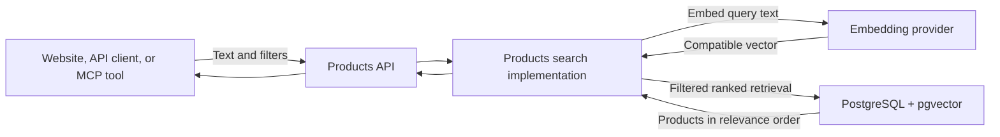
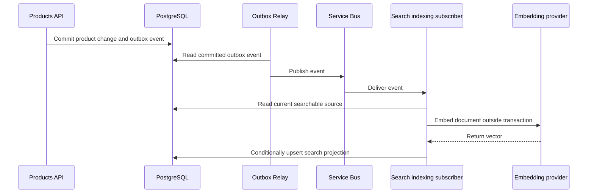

# Product search: from keywords to vectors

This guide explains how product search works, why vectors can help, and how we intend to extend the Contoso Products sample using PostgreSQL and pgvector. It assumes no previous experience with embeddings, vector databases, or search engines.

The goal is not merely to store some numbers and label the result "AI". It is to demonstrate an understandable search capability with correct filtering, reliable updates, and evidence of useful results.

**Read this as both a learning guide and a living design.** The status below separates working sample behavior from proposed implementation. SQL examples illustrate the design; they are not migrations to run against the current database.

## Implementation status

| Capability | Status | What that means |
|---|---|---|
| CoreEx `QueryArgs.Search` and search parser configuration | Implemented | REST, HTTP clients, OpenAPI, and GraphQL-lite can carry search text. |
| Products keyword search | Implemented | Every distinct whitespace-separated term must match the product text or the beginning of its SKU. |
| MCP `search_products` forwarding to Products | Implemented | The tool calls the Products API with `$search`; it does not query the database. |
| Ranked-search mode plumbing | Implemented | CoreEx validates and carries ranked search intent; the repository must execute it. |
| Product search document and separate search projection | Proposed | No product embeddings are currently stored. |
| Embedding provider and pgvector semantic retrieval | Proposed | No embedding model is currently configured or called. |
| PostgreSQL full-text retrieval and hybrid ranking | Proposed | The current sample does not perform full-text or hybrid search. |
| Asynchronous search indexing and backfill | Proposed | The outbox and subscriber foundations exist; search-specific processing does not. |
| Real-model relevance evaluation and HNSW benchmark | Proposed | Existing keyword tests are not evidence of semantic-search quality or scale. |

The proposed baseline is PostgreSQL as the search store, one embedding per product, a rebuildable search projection, and indexing outside product-write transactions. Model selection, vector dimensions, final schema, retrieval windows, and count semantics still need to be resolved during implementation.

## Reading map

- [Start with the three kinds of search](#three-kinds-of-search).
- [Learn what embeddings and distances mean](#embeddings-text-as-coordinates).
- [Understand PostgreSQL storage and retrieval](#postgresql-and-pgvector).
- [Follow the proposed sample architecture](#where-this-fits-in-the-sample).
- [See how indexing stays correct](#keeping-search-current).
- [Understand hybrid ranking](#hybrid-search-combining-two-result-lists).
- [Review the implementation stages and evidence](#implementation-stages).
- [Keep this guide aligned with the code](#keeping-this-guide-in-sync).

## Three kinds of search

Imagine a catalog containing "Muc-Off Nano Tech Bike Cleaner".

### Keyword search: find these words

A keyword search asks whether particular text occurs in selected fields. The implemented sample splits a request into whitespace-separated terms, requires every term to match, and allows each term to match either the product text or the SKU prefix.

```text
GET /api/products?$search=rear%20derailleur
```

This finds products whose configured fields collectively match both words. It is not phrase matching: the words do not have to be adjacent. Repeated terms are deduplicated case-insensitively.

Keyword search is simple, predictable, and useful. It is not inherently inferior to vectors. For an exact identifier, it may be the better tool.

### Lexical full-text search: understand word forms and rank matches

A full-text search engine processes words into searchable tokens and can rank matching documents. It can handle language features such as reducing "bikes" to a shared word form and ignoring common words.

PostgreSQL provides full-text search without pgvector. This is more sophisticated than substring matching, but it still primarily matches words, not general meaning.

### Semantic search: find related meaning

Semantic search can connect:

```text
User: "something to clean mud off my bike"
Product: "Muc-Off Nano Tech Bike Cleaner"
```

The words differ, but their meanings are related. An embedding model provides the numerical representation used to discover that relationship.

### Hybrid search: use both signals

Product catalogs contain both natural-language concepts and exact names or identifiers. Hybrid search combines lexical and semantic retrieval, so one approach can compensate for the other's weaknesses.

It is a recommendation for this sample, not a universal requirement. Whether it improves results must be measured.

## Search versus filtering

Search and filtering answer different questions:

| Capability | Question | Example |
|---|---|---|
| `$filter` | Which records satisfy explicit conditions? | `brand eq 'YETI'` |
| `$search` | Which records match this text or intent? | `trail bike` |
| `$orderby` | In what sequence should records appear? | `text desc` |
| Paging | Which portion of the result should be returned? | `$take=10` |

For example:

```text
GET /api/products?$search=trail%20bike&$filter=brand%20eq%20'YETI'&$take=10
```

This should retrieve the most relevant eligible Yeti products, not search the entire catalog for ten products and then discard non-Yeti entries.

Keyword mode allows ordinary ordering. Ranked modes own relevance ordering: CoreEx rejects an explicit `$orderby` and does not apply the configured default ordering.

The server configuration selects the mode. There is currently no public `$searchMode` parameter.

Price, availability, and other hard constraints belong in structured filtering, not in assumptions about what an embedding understands. The current Products filter configuration does not expose price or inventory filters; those would require explicit additions.

See the [CoreEx querying guide](../../src/CoreEx.Data/Querying/README.md) for actual parser configuration and syntax.

## Embeddings: text as coordinates

An **embedding** is an array of numbers produced by a trained model. Texts with related meanings tend to receive nearby representations.

An **embedding model** is the component that turns text into that array. It is not necessarily the chat model used by an AI assistant.

Illustrative output might look like this:

```text
"bike cleaner"       -> [0.12, -0.48, 0.31, ...]
"remove bicycle mud" -> [0.15, -0.43, 0.29, ...]
```

These are made-up numbers to show the shape, not real embeddings.

### What is a dimension?

Each position in the array is a dimension. Real models often produce hundreds or thousands of dimensions.

Do not picture a hand-written spreadsheet with "bicycle" in column one and "cleaning" in column two. Meaning is distributed across the coordinates learned by the model; individual dimensions usually do not have simple human-readable labels.

The useful mental model is a map of relationships. Similar meanings tend to be near one another on that map.

### Products and queries need compatible maps

At indexing time, embed product text and store its vector. At query time, embed the user's text and compare it with those stored vectors. Do not regenerate every product embedding for each request.

Both sides need compatible embedding profiles:

- The same model and compatible version.
- The same output dimensions.
- The correct document/query instructions for that model.
- Consistent preprocessing and any required normalization.

Some models require different prefixes or instructions for queries and documents. Follow the model's documented retrieval recipe rather than assuming identical inputs are always appropriate.

Equal dimensions do not establish compatibility. An RGB color and a three-dimensional location both contain three numbers; comparing them would still be nonsense.

### Embedding is not answer generation

Generating an embedding does not write an answer or invent new product facts. Retrieval finds candidate records. An AI client may subsequently explain those records to a user.

That explanation is a separate step, and the returned product data remains the authoritative evidence.

## PostgreSQL and pgvector

**pgvector** is a PostgreSQL extension that adds vector types, distance operators, and optional nearest-neighbor indexes. It does not call an embedding model.

An **extension** is additional database functionality installed on the server and enabled in a database. `CREATE EXTENSION` cannot install server binaries that are absent.

The current Compose setup uses a plain, unpinned `postgres` image. Implementation will need a compatible, pinned image containing pgvector, plus a database migration enabling the extension. Changing database images or major versions requires checking compatibility and preserving existing local data.

### Proposed storage

A **search projection** is derived data prepared for retrieval. It can be rebuilt from the authoritative products.

The proposed one-to-one projection could have this shape:

```sql
-- Illustrative only: names, dimensions, and constraints are not finalized.
CREATE EXTENSION IF NOT EXISTS vector;

CREATE TABLE products.product_search
(
    product_id text PRIMARY KEY,
    document_text text NOT NULL,
    embedding vector(768) NOT NULL,
    embedding_profile text NOT NULL,
    source_hash text NOT NULL,
    embedded_at timestamptz NOT NULL DEFAULT now()
);
```

The `768` is an example, not a chosen model dimension. Choose the model first, then the storage type and index strategy. The final design must also define ownership/foreign keys, deletion handling, full-text storage, and profile migration.

Why a separate table instead of another product column?

- Ordinary CRUD need not load large vectors.
- Product contracts do not acquire provider-specific properties.
- Indexing need not change the business entity's ETag or changelog.
- Model/profile metadata and freshness are explicit.
- Search can be rebuilt without rewriting business records.

Putting a vector on the product table is also legitimate for simpler applications. Separation here makes the derived-state lesson clearer.

### Distance: how near are two vectors?

**Cosine similarity** compares the direction of two vectors:

```text
cosine similarity = dot product / (length of first vector * length of second vector)
cosine distance   = 1 - cosine similarity
```

A dot product multiplies corresponding coordinates and adds them. Vector length measures the magnitude of the array as a point in that space.

With cosine distance, smaller means closer. pgvector uses the `<=>` operator:

```sql
SELECT product_id,
       embedding <=> @query_vector AS distance
FROM products.product_search
ORDER BY embedding <=> @query_vector
LIMIT @take;
```

`@query_vector` and `@take` represent application-bound parameters, not SQL assembled by concatenating user text. This introductory example omits eligibility and profile checks; those are mandatory in the real repository.

Other metrics include Euclidean distance and inner product. Use the embedding model's intended metric; cosine is a starting candidate, not an unconditional rule.

For index-backed nearest-neighbor retrieval, preserve the supported distance expression in ascending `ORDER BY` with a limit. Ordering instead by a transformed similarity expression can prevent the intended index plan.

### A score is not confidence

A similarity of `0.82` does not mean an 82% probability of relevance. It is a geometric score, whose meaning depends on the model and dataset.

Nearest-neighbor search still returns neighbors for an unrelated request such as "replacement submarine propeller". Nearest does not mean suitable.

There is no universal relevance threshold. The sample needs unrelated-query examples and an evaluated policy for handling weak results rather than arbitrary confidence labels.

## Choosing the searchable product document

The **search document** is the text we deliberately prepare for the embedding model and lexical retrieval.

Current product data includes short names, SKU, category/subcategory, brand, and tags. Many names contain little explanatory content.

A canonical document might be:

```text
Name: Yeti ASR C2
Brand: Yeti
Category: Bikes
Subcategory: Cross-country
Tags: cross-country, full-suspension
```

Only include verified attributes. If the demonstration needs concepts such as weight, riding style, or component compatibility, add accurate descriptive data or select examples that the existing data supports.

Do not generate invented product specifications merely to make semantic results impressive.

### Keep rapidly changing facts relational

Generally exclude price, current stock, and activity status from embeddings. Retrieve or filter these from live product data.

Otherwise a price change can leave the stored embedding representing yesterday's price. Hard constraints must not depend on asynchronous re-embedding.

### One product, one vector

One embedding per product is the proposed baseline.

**Chunking** means splitting a long document into smaller passages and embedding them separately. It is useful for manuals and lengthy articles, not automatically useful for a short catalog record.

Searching product manuals could later introduce multiple passages per product, but that is a different retrieval shape.

### Record how each vector was made

An embedding profile should identify the model/version, output dimensions, and document-template version. A source hash identifies the exact searchable content.

A **hash** is a compact fingerprint of content. It allows us to recognize unchanged documents without comparing or embedding them repeatedly. It does not establish which of two versions is newer.

Changing models is an index migration. For a live system, build a compatible new projection alongside the old one, then switch coherently. Do not mix incompatible vectors just because they fit the same column.

## Where this fits in the sample

The Products domain owns search because it owns the catalog and its eligibility rules. MCP is a client-facing tool surface, not a second search engine.



This is the proposed ranked flow. Today the repository executes keyword search without an embedding provider.

**CoreEx responsibilities:** carry intent through `QueryArgs`, validate configured constraints, apply keyword predicates, and distinguish ranked search from ordinary ordering.

**Products implementation responsibilities:** prepare documents, generate embeddings, execute provider-specific queries, enforce eligibility, maintain derived state, and evaluate relevance/performance.

The existing `ProductRepository.QueryAsync` joins product, subcategory, and inventory data. Ranked retrieval must preserve that behavior and all configured filters rather than quietly implementing a reduced API.

Application orchestration should depend on application-owned interfaces. Embedding transport/SDK and pgvector access belong in Infrastructure, composed by the hosts. The exact interface names are not yet chosen.

The .NET pgvector integration supports Npgsql and EF Core. Versions must match this repository's EF/Npgsql target matrix; external Npgsql data sources and EF options must both be configured where required. Database changes remain owned by DbEx migrations and regeneration, not hand-edited generated files.

### What MCP adds

MCP (Model Context Protocol) lets an AI client discover and invoke tools such as `search_products`.

The tool sends search text to Products and returns product data. It does not generate its own embeddings, query PostgreSQL directly, or maintain its own index. Non-MCP clients use the same capability.

After switching the sample to ranked search, update the tool description to describe the actual behavior instead of promising keyword matching.

Search does not resolve authentication or authorization. The sample's existing authentication gaps remain separate concerns.

## Keeping search current

Product CRUD already commits product mutations and outgoing events together using the transactional outbox.

An **outbox** stores an event in the same database transaction as its business change. A **relay** forwards committed events to the broker. A **subscriber** handles delivered events.

The proposed indexing flow reuses that foundation:



This is **eventual consistency**: the product write can succeed before its search representation catches up. A freshly created product may temporarily be absent from semantic results; updated content may temporarily retrieve using its older representation.

The API must not wait for external inference inside a product-write transaction. That would tie business writes to model availability and hold database resources during inference.

The existing Products Subscribe host is a natural home for the worker. A dedicated subscription/receiver may isolate slower indexing from reservation commands without adding another host. Broker subscription rules, handler registration, concurrency, retries, and dead-letter behavior all need explicit wiring.

### Duplicate delivery is normal

At-least-once delivery means an event can arrive multiple times. The handler must be **idempotent**: retrying the same work must not corrupt state.

The proposed handler should:

1. Load current authoritative product data instead of blindly using an old event payload.
2. Construct the canonical document and source hash.
3. Skip work if the stored hash/profile already matches.
4. Generate the embedding outside a database transaction.
5. Recheck source freshness before writing.
6. Store only if the result still corresponds to current source state; otherwise schedule/retry fresh work.

The final check/write requires a concurrency strategy, not just two unrelated reads. A short transaction with an appropriate lock/version check can prevent an older worker overwriting a newer projection.

If reference-data descriptions contribute to the document, changes to those descriptions must also trigger or schedule reindexing of affected products.

### Deactivation and deletion

Live eligibility must exclude deleted or inactive products when appropriate, even while their old vectors remain stored. Deletion should also clean up the projection.

Search eligibility must not rely solely on yesterday's indexed status.

### Existing products and missed work

Events do not automatically index pre-existing products. A **backfill** processes existing records; **reindexing** rebuilds records after a model/template change or repair.

Provide an explicit resumable operation using the same builder and profile as event processing. It should batch work, skip current records, report failures, and support reconciliation after missed events or dead-lettered work.

### Provider failures

Embedding failures must be visible and retriable according to the operation's policy. Product writes should remain independent.

A configured ranked request must not silently become keyword search or a successful empty result because inference failed. Any deliberate fallback needs explicit configuration, documentation, and observable behavior.

## Exact and approximate nearest neighbors

**Exact search** calculates distances over the eligible vectors and returns the actual nearest vectors. Start here for the small catalog.

Exact vector neighbors are not necessarily perfect human matches. Exactness describes the distance calculation, not the model's understanding.

**Approximate nearest-neighbor search (ANN)** uses an index to search promising regions instead of evaluating every vector. It trades some recall for speed.

**Recall** here means how many true nearest neighbors the approximate search recovers relative to exact search.

### HNSW

HNSW (Hierarchical Navigable Small World) organizes vectors into a multilayer graph. Broad upper layers guide navigation; denser lower layers explore nearby candidates.

An illustrative cosine index is:

```sql
CREATE INDEX product_search_embedding_hnsw
ON products.product_search
USING hnsw (embedding vector_cosine_ops);
```

More graph exploration can improve recall at the cost of latency. Construction choices affect memory, build time, and update cost.

IVFFlat is another pgvector index, grouping vectors into lists and searching selected lists. It has different build, memory, and recall tradeoffs; it is not necessary for the first implementation.

For supported approximate indexes, dimensional limits depend on the type/operator class and pgvector version. Confirm model dimensions before choosing `vector`, `halfvec`, or another representation.

An HNSW index over a few dozen rows is not proof of scalability. PostgreSQL may correctly choose a sequential scan. Use a separate larger corpus and `EXPLAIN (ANALYZE, BUFFERS)` to study actual plans and costs.

### Filtering has two layers

At the application level, put eligibility and client filters inside retrieval, before the candidate limit. Include authorization/tenant restrictions where applicable and embedding-profile compatibility.

At the index level, an approximate scan may find candidates before PostgreSQL filters them. Restrictive filters can therefore return fewer results than requested even with correct SQL.

Options include exact search over a selective subset, greater search effort, iterative scans, or suitable partial indexes/partitioning. Iterative scans explore more candidates but still have limits; they are not a guarantee of perfect recall.

Settings that vary per request must not leak through pooled connections. Use transaction-local settings where appropriate.

Do not glue retrieval to filtering by loading huge lists of eligible IDs into application memory. Prove database-side composition against the existing repository shape.

## Hybrid search: combining two result lists

PostgreSQL full-text search uses:

| Term | Meaning |
|---|---|
| `tsvector` | Processed document words, often called lexemes, with optional positions/weights. |
| `tsquery` | Processed query conditions over those words. |
| `@@` | Tests whether a document matches a text query. |
| `ts_rank` / `ts_rank_cd` | PostgreSQL functions for ranking lexical matches. |
| GIN index | An index useful for finding documents containing lexemes. |

A `tsvector` is not a neural embedding. PostgreSQL's built-in rank functions are not BM25 by default.

`plainto_tsquery` is a straightforward candidate for our opaque text contract: it processes plain text and ANDs surviving words. Long conversational queries may produce few lexical matches.

`websearch_to_tsquery` recognizes syntax such as quotes, OR, and negation. Choosing it would deliberately introduce provider-specific query interpretation that needs documenting. CoreEx does not currently promise that grammar.

SKUs need explicit treatment because punctuation and language tokenization can behave differently from ordinary prose. Exact SKU matching is a useful separate signal, not something to leave to semantic similarity.

### Why not just add the scores?

Lexical rank and cosine similarity have different scales. Adding them without calibration can make one signal dominate for accidental numerical reasons.

**Reciprocal Rank Fusion (RRF)** combines positions instead:

```text
fused score(document) = sum over branches of weight / (k + rank)
```

Ranks start at one. A document missing from a branch contributes nothing from that branch.

Suppose:

```text
Lexical list:  A, B, C
Semantic list: B, D, A
```

A and B benefit from appearing in both lists. The constant `k` smooths the effect of position; 60 is a common starting value, not a universal optimum.

Retrieve a bounded candidate pool from each eligible branch, combine by product ID, fuse ranks, apply a deterministic tie-breaker, and return the requested window.

The candidate pool is usually larger than the final page. Its size affects both quality and work; ten returned products does not imply ten candidates per branch are sufficient.

RRF improves transparency: we can show lexical rank, semantic rank, and fused rank without introducing another inference model. A later reranker could assess query/document pairs more deeply, but it adds latency and complexity and is not part of the baseline.

## Results, counts, and paging

Keep vectors out of public product contracts. Initially, existing `ProductLite` responses in relevance order are sufficient. Diagnostic tooling can report component scores separately.

Switching Products from keyword to semantic/hybrid is a behavior change, not merely internal optimization. Update schema, API examples, MCP descriptions, and tests together.

Ranked search must define its result window and count semantics:

- "All eligible products" is not "all relevant products".
- Nearest-neighbor retrieval has no inherent binary match count.
- A bounded hybrid pool is not the entire set of potential matches.
- Deep offset paging can require increasingly large candidate retrieval.
- Stable tie-breaking does not freeze rankings when content or indexes change.

Before implementation is complete, record the chosen behavior for `$skip`, `$take`, `$count`, maximum ranked window, and empty/weak matches. Do not report candidate count as total match count without making that meaning explicit.

## Model hosting and operational costs

A locally runnable, pinned model is attractive for a self-contained learning sample, but "local" is not "free". Downloads, licensing, RAM, CPU/GPU needs, startup time, and query latency still matter.

A hosted provider can simplify execution on developer machines, but introduces credentials, usage charges, network latency, availability, and data-transfer/privacy considerations.

No provider or model is selected yet. Document the actual model, retrieval instructions, dimensions, resource requirements, and setup once chosen.

Measure document and query embedding separately. Caching repeated query embeddings can help, but keys must include the profile and relevant preprocessing; user text may be sensitive, so retention/logging needs care.

Trace embedding time, database time, indexing lag, retries, and failures. Avoid logging raw vectors, credentials, or full user queries by default.

## Implementation stages

| Stage | Learning objective | Evidence required |
|---|---|---|
| 1. Documents and embeddings | See how verified catalog content becomes vectors. | Selected profile, reproducible builder, provider configuration, provenance. |
| 2. Exact pgvector retrieval | Understand distance ordering with real filters. | Real database tests for ordering, eligibility, profile isolation, and paging policy. |
| 3. Full-text and RRF | Compare exact terminology with semantic intent. | Inspectable branch ranks and curated hybrid comparisons. |
| 4. Indexing and backfill | Maintain rebuildable derived state. | Duplicate/out-of-order handling, stale-write protection, updates/deletes, recovery. |
| 5. HNSW benchmark | Measure speed versus recall at meaningful scale. | Exact baseline, larger corpus, real query plans, latency and recall results. |
| 6. MCP demonstration | Reuse the domain capability from an AI client. | Same API behavior, accurate tool descriptions, cross-host demonstration. |

These are teaching milestones, not instructions to ship ranked search without lifecycle support. Completion requires the corresponding operational behavior, not only the read query.

### Two different kinds of testing

**Deterministic engineering tests** use controlled embeddings/provider stubs to verify distance ordering, filters, failure handling, idempotency, and freshness against real PostgreSQL where appropriate.

**Real-model evaluation** uses a pinned model and a curated set of queries with expected relevant products. Include exact SKUs, paraphrases, ambiguous intent, restrictive filters, and requests outside the catalog.

A fake embedding generator proves plumbing, not semantic understanding. Real-model evaluation should be identifiable and reproducible rather than unexpectedly introducing a paid/network dependency into ordinary unit tests.

For evaluation:

| Measurement | What it tells us |
|---|---|
| Precision at K | How many of the first K results are relevant. |
| Recall at K | How many known relevant results appear in the first K. |
| nDCG at K | Whether more relevant results appear higher, using graded relevance judgments. |
| ANN recall | How closely approximate neighbors reproduce exact vector neighbors. |
| Latency distribution | Typical and slower-request times, including embedding and database work. |
| Indexing freshness | Delay between committed source changes and updated searchable state. |

ANN recall and human relevance are different measurements. A fast index can faithfully reproduce poor embeddings.

## Implementation map

These existing files are the starting points, not claims that the proposed functionality already lives there:

| Existing surface | Relevance |
|---|---|
| [Product query configuration](../src/Contoso.Products.Infrastructure/Repositories/ProductQueryArgsConfig.cs) | Current keyword fields and future server-selected ranked mode. |
| [Product repository](../src/Contoso.Products.Infrastructure/Repositories/ProductRepository.cs) | Existing filters, joins, ordering, mapping, and paging to preserve. |
| [Product read service](../src/Contoso.Products.Application/ProductReadService.cs) | Current query delegation through the Application boundary. |
| [Product service](../src/Contoso.Products.Application/ProductService.cs) | Atomic product mutations and outbox events. |
| [Product contract](../src/Contoso.Products.Contracts/ProductBase.cs) | Current authoritative catalog attributes. |
| [Database configuration](../src/Contoso.Products.Database/dbex.yaml) | DbEx-owned persistence generation and schema configuration. |
| [DbContext](../src/Contoso.Products.Infrastructure/Repositories/ProductsDbContext.cs) | Hand-authored EF/Npgsql composition; generated partials remain generator-owned. |
| [Subscribe host](../src/Contoso.Products.Subscribe/Program.cs) | Existing message receiving/composition foundations. |
| [MCP tools](../src/Contoso.Mcp/Tools/CommerceTools.cs) | API-only search forwarding and tool description. |
| [Compose infrastructure](../../docker-compose.yml) | PostgreSQL image and potential local inference resource. |
| [Product query tests](../tests/Contoso.Products.Test.Api/ReadTests.ProductQuery.cs) | Current keyword API behavior and schema expectations. |

See also [layer boundaries](layers.md), [Infrastructure](infrastructure-layer.md), [messaging hosts](hosts-layer.md), [tooling](tooling.md), [testing](testing.md), and [Aspire](aspire.md).

## Keeping this guide in sync

Treat documentation as part of each search implementation change, not a final clean-up exercise.

When a stage lands:

1. Update the status table only for behavior that is implemented and verified.
2. Replace illustrative decisions with the actual model/profile, schema, settings, and failure behavior; explain meaningful deviations.
3. Add links to the owning implementation and tests. Remove obsolete proposed details rather than keeping conflicting narratives.
4. Add runnable setup/backfill/evaluation commands when they exist. Put environment setup in [local-dev.md](local-dev.md) and cross-host wiring in [aspire.md](aspire.md), linking from here instead of duplicating them.
5. Update API examples, schema expectations, MCP descriptions, and observable behavior together.

Keep unresolved choices explicitly unresolved. If the implementation remains keyword-only, this page must continue to say so. Never turn a proposed design into present-tense documentation just because the SQL looks convincing.

## Primary references

- [pgvector](https://github.com/pgvector/pgvector): vector types, metrics, exact/approximate retrieval, HNSW, filtering, and iterative scans.
- [pgvector for .NET](https://github.com/pgvector/pgvector-dotnet): Npgsql and EF Core integration and version compatibility.
- [PostgreSQL full-text search controls](https://www.postgresql.org/docs/current/textsearch-controls.html): lexemes, query parsing, weighting, and ranking.
- [CoreEx querying](../../src/CoreEx.Data/Querying/README.md): the implemented `$filter`, `$orderby`, and `$search` contract.

Upstream documentation evolves. Pin implementation dependencies and verify their version-specific behavior instead of assuming the latest upstream README describes an older installed release.
