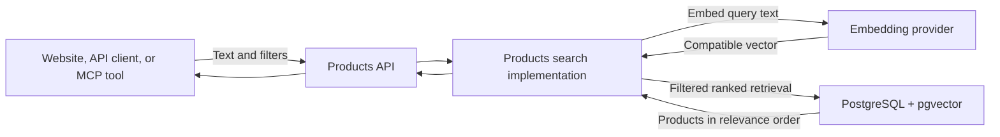
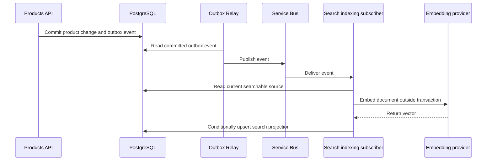

# Product search: from keywords to vectors

This guide explains how product search works, why vectors can help, and how the Contoso Products sample uses PostgreSQL and pgvector. It assumes no previous experience with embeddings, vector databases, or search engines.

The goal is not merely to store some numbers and label the result "AI". It is to demonstrate an understandable search capability with correct filtering, reliable updates, and evidence of useful results.

**Read this as both a learning guide and a living design.** The status below separates working sample behavior from proposed implementation. SQL examples illustrate the design; they are not migrations to run against the current database.

## Implementation status

| Capability | Status | What that means |
|---|---|---|
| CoreEx `QueryArgs.Search` and search parser configuration | Implemented | REST, HTTP clients, OpenAPI, and GraphQL-lite can carry search text. |
| Products semantic search | Implemented; default for `$search` | Exact cosine-distance ranking replaces the earlier keyword matching. Requests without `$search` retain ordinary filtering and ordering. |
| MCP `search_products` forwarding to Products | Implemented | The tool calls the Products API with `$search`; it does not query the database. |
| Ranked-search mode plumbing | Implemented | CoreEx validates and carries ranked search intent; the repository must execute it. |
| Canonical product search document | Implemented | Versioned, whitespace-normalized documents and source hashes exclude price, status, inventory and business metadata. |
| Product descriptions and price filtering | Implemented | Optional descriptive content supports CRUD; decimal price constraints use existing REST and GraphQL-lite query configuration. |
| Local embedding provider | Implemented | Ollama/Nomic document and query instructions, response validation, and an Application adapter boundary are available. |
| Separate search projection and pgvector semantic retrieval | Implemented | PostgreSQL stores 768-dimensional embeddings and computes exact, filtered cosine-distance rankings. |
| PostgreSQL full-text retrieval and hybrid ranking | Proposed | The current sample does not perform full-text or hybrid search. |
| Explicit backfill / asynchronous search indexing | Implemented | Test setup publishes an atomic initial backfill; one globbed product-event subscriber reconciles subsequent changes, including logical deletion. |
| Real-model relevance evaluation | Baseline measured; monthly/manual workflow configured | A version-controlled, 24-query judged set, isolated-catalog setup, opt-in REST/Ollama runner, and real report are available. Scores are observations, not quality gates. |
| HNSW benchmark | Proposed | Exact full-catalog retrieval is still the comparison baseline; index performance has not been measured. |

The implemented baseline is PostgreSQL as the search store, one embedding per product/profile/recipe, a rebuildable search projection, and indexing outside product-write transactions. It uses local Ollama with Nomic v1.5 and 768 dimensions. Exact retrieval ranks eligible **indexed** products; count means the number of those candidates, not the number judged relevant or the complete catalog size. Full-text/hybrid retrieval windows remain future work.

## Reading map

- [Start with the three kinds of search](#three-kinds-of-search).
- [Learn what embeddings and distances mean](#embeddings-text-as-coordinates).
- [Understand PostgreSQL storage and retrieval](#postgresql-and-pgvector).
- [Follow the sample architecture](#where-this-fits-in-the-sample).
- [See how indexing stays correct](#keeping-search-current).
- [Understand hybrid ranking](#hybrid-search-combining-two-result-lists).
- [Review the implementation stages and evidence](#implementation-stages).
- [Keep this guide aligned with the code](#keeping-this-guide-in-sync).

## Three kinds of search

Imagine a catalog containing "Muc-Off Nano Tech Bike Cleaner".

### Keyword search: find these words

A keyword search asks whether particular text occurs in selected fields. The sample's earlier keyword implementation split a request into whitespace-separated terms, required every term to match, and allowed each term to match either the product text or the SKU prefix. CoreEx still supports that mode; Products has now deliberately switched to semantic mode.

```text
GET /api/products?$search=rear%20derailleur
```

In keyword mode this finds products whose configured fields collectively match both words. It is not phrase matching: the words do not have to be adjacent. Repeated terms are deduplicated case-insensitively. In the current Products semantic mode, this same request instead returns nearby meanings in relevance order.

Keyword search is simple, predictable, and useful. It is not inherently inferior to vectors. For an exact identifier, it may be the better tool.

### Lexical full-text search: understand word forms and rank matches

A full-text search engine processes words into searchable tokens and can rank matching documents. It can handle language features such as reducing "bikes" to a shared word form and ignoring common words.

PostgreSQL provides full-text search without pgvector. This is more sophisticated than substring matching, but it still primarily matches words, not general meaning.

### Semantic search: find related meaning

Semantic search can connect:

```text
User: "something to clean mud off my bike"
Product: "Muc-Off Nano Tech Bike Cleaner"
```

The words differ, but their meanings are related. An embedding model provides the numerical representation used to discover that relationship.

### Hybrid search: use both signals

Product catalogs contain both natural-language concepts and exact names or identifiers. Hybrid search combines lexical and semantic retrieval, so one approach can compensate for the other's weaknesses.

It is a recommendation for this sample, not a universal requirement. Whether it improves results must be measured.

## Search versus filtering

Search and filtering answer different questions:

| Capability | Question | Example |
|---|---|---|
| `$filter` | Which records satisfy explicit conditions? | `brand eq 'YETI'` |
| `$search` | Which records match this text or intent? | `trail bike` |
| `$orderby` | In what sequence should records appear? | `text desc` |
| Paging | Which portion of the result should be returned? | `$take=10` |

For example:

```text
GET /api/products?$search=trail%20bike&$filter=brand%20eq%20'YETI'&$take=10
```

This should retrieve the most relevant eligible Yeti products, not search the entire catalog for ten products and then discard non-Yeti entries.

Keyword mode allows ordinary ordering. Ranked modes own relevance ordering: CoreEx rejects an explicit `$orderby` and does not apply the configured default ordering.

The server configuration selects the mode; Products now selects semantic mode. There is no public `$searchMode` parameter. Semantic text is limited to 200 normalized characters, but the keyword-only eight-term limit no longer applies.

Price, availability, and other hard constraints belong in structured filtering, not in assumptions about what an embedding understands. Products exposes a decimal `price` filter with `eq`, `ne`, `in`, `gt`, `ge`, `lt` and `le`; inventory filters are not currently exposed.

```text
GET /api/products?$search=cleaner&$filter=price%20lt%2020
GET /api/products?$filter=price%20ge%2099%20and%20price%20lt%20130
```

GraphQL-lite uses the same configuration, for example `products(where: {price: {ge: 99, lt: 130}})`. No generic `QueryArgs` changes or client-supplied vectors are needed.

See the [CoreEx querying guide](../../src/CoreEx.Data/Querying/README.md) for actual parser configuration and syntax.

## Embeddings: text as coordinates

An **embedding** is an array of numbers produced by a trained model. Texts with related meanings tend to receive nearby representations.

An **embedding model** is the component that turns text into that array. It is not necessarily the chat model used by an AI assistant.

Illustrative output might look like this:

```text
"bike cleaner"       -> [0.12, -0.48, 0.31, ...]
"remove bicycle mud" -> [0.15, -0.43, 0.29, ...]
```

These are made-up numbers to show the shape, not real embeddings.

### What is a dimension?

Each position in the array is a dimension. Real models often produce hundreds or thousands of dimensions.

Do not picture a hand-written spreadsheet with "bicycle" in column one and "cleaning" in column two. Meaning is distributed across the coordinates learned by the model; individual dimensions usually do not have simple human-readable labels.

The useful mental model is a map of relationships. Similar meanings tend to be near one another on that map.

### Products and queries need compatible maps

At indexing time, embed product text and store its vector. At query time, embed the user's text and compare it with those stored vectors. Do not regenerate every product embedding for each request.

Both sides need compatible embedding profiles:

- The same model and compatible version.
- The same output dimensions.
- The correct document/query instructions for that model.
- Consistent preprocessing and any required normalization.

Some models require different prefixes or instructions for queries and documents. Follow the model's documented retrieval recipe rather than assuming identical inputs are always appropriate.

Equal dimensions do not establish compatibility. An RGB color and a three-dimensional location both contain three numbers; comparing them would still be nonsense.

### Embedding is not answer generation

Generating an embedding does not write an answer or invent new product facts. Retrieval finds candidate records. An AI client may subsequently explain those records to a user.

That explanation is a separate step, and the returned product data remains the authoritative evidence.

## PostgreSQL and pgvector

**pgvector** is a PostgreSQL extension that adds vector types, distance operators, and optional nearest-neighbor indexes. It does not call an embedding model.

An **extension** is additional database functionality installed on the server and enabled in a database. `CREATE EXTENSION` cannot install server binaries that are absent.

Compose uses `docker.io/pgvector/pgvector:0.8.2-pg18-trixie`: pgvector 0.8.2 on PostgreSQL 18. The Products migration enables `vector` and creates the search projection. Changing database images or major versions requires checking compatibility; do not reuse a data directory across incompatible PostgreSQL major versions. The local switch retained the existing PostgreSQL 18 data volume.

### Implemented storage

A **search projection** is derived data prepared for retrieval. It can be rebuilt from the authoritative products.

The current projection has this shape (see the migration for complete constraints):

```sql
CREATE TABLE products.product_search (
    product_id varchar(50) NOT NULL REFERENCES products.product(product_id) ON DELETE CASCADE,
    profile varchar(250) NOT NULL,
    recipe varchar(50) NOT NULL,
    source_hash char(64) NOT NULL,
    document text NOT NULL,
    embedding vector(768) NOT NULL CHECK (vector_norm(embedding) > 0),
    indexed_on timestamptz NOT NULL,
    PRIMARY KEY (product_id, profile, recipe)
);
```

The `768` is Nomic's selected native dimensionality. The composite primary key permits separate profiles/recipes without mixing them in retrieval. There is no HNSW or IVFFlat index: PostgreSQL evaluates exact distances. Full-text storage and coherent profile rollout remain later milestones.

Why a separate table instead of another product column?

- Ordinary CRUD need not load large vectors.
- Product contracts do not acquire provider-specific properties.
- Indexing need not change the business entity's ETag or changelog.
- Model/profile metadata and freshness are explicit.
- Search can be rebuilt without rewriting business records.

Putting a vector on the product table is also legitimate for simpler applications. Separation here makes the derived-state lesson clearer.

### Distance: how near are two vectors?

**Cosine similarity** compares the direction of two vectors:

```text
cosine similarity = dot product / (length of first vector * length of second vector)
cosine distance   = 1 - cosine similarity
```

A dot product multiplies corresponding coordinates and adds them. Vector length measures the magnitude of the array as a point in that space.

With cosine distance, smaller means closer. pgvector uses the `<=>` operator:

```sql
SELECT product_id,
       embedding <=> @query_vector AS distance
FROM products.product_search
ORDER BY embedding <=> @query_vector
LIMIT @take;
```

`@query_vector` and `@take` represent application-bound parameters, not SQL assembled by concatenating user text. This introductory example omits eligibility and profile checks; those are mandatory in the real repository.

Other metrics include Euclidean distance and inner product. Use the embedding model's intended metric; cosine is a starting candidate, not an unconditional rule.

For index-backed nearest-neighbor retrieval, preserve the supported distance expression in ascending `ORDER BY` with a limit. Ordering instead by a transformed similarity expression can prevent the intended index plan.

### A score is not confidence

A similarity of `0.82` does not mean an 82% probability of relevance. It is a geometric score, whose meaning depends on the model and dataset.

Nearest-neighbor search still returns neighbors for an unrelated request such as "replacement submarine propeller". Nearest does not mean suitable.

There is no universal relevance threshold. The sample needs unrelated-query examples and an evaluated policy for handling weak results rather than arbitrary confidence labels.

## Choosing the searchable product document

The **search document** is the text we deliberately prepare for the embedding model and lexical retrieval.

Current product data includes short names, an optional `Description`, SKU, category/subcategory, brand, and tags. Many names contain little explanatory content, so descriptions explain product function and intended use.

A canonical document might be:

```text
Name: Yeti ASR C2
SKU: YETI-ASR-C2-2025
Description: ...
Brand: Yeti Cycles
Category: Bikes
Subcategory: Cross country
Tags: cross-country, full-suspension
```

Only include verified attributes. If the demonstration needs concepts such as weight, riding style, or component compatibility, add accurate descriptive data or select examples that the existing data supports.

Do not generate invented product specifications merely to make semantic results impressive.

`Description` is optional plain text, limited to 2,000 characters in validation and PostgreSQL. It is returned in full-product and `ProductLite` responses and editable through existing POST, PUT and merge-PATCH endpoints; PATCH can explicitly clear it with `{"description":null}`. Updates retain the existing ETag, changelog and transactional-outbox behavior. The search document recipe is now `product-document-v2`, and description edits change its source hash; price changes do not.

Descriptions are included in embedding documents. The current semantic `$search` uses their meaning alongside names, SKU and classifications; it does not require literal keyword matches. For guaranteed SKU matching, use `$filter=sku eq '...'`, not semantic similarity.

### Where the seeded descriptions come from

Both Products read and mutation seed files contain the same original, short descriptions for all 32 entries. These are paraphrases of product function and intended use, not copied marketing text. The sources below support those statements; they do not validate the sample prices, every build's components, or every model-year SKU.

Several sources describe a model family rather than the exact seeded build. The descriptions deliberately avoid travel numbers, model-year changes and precise component specifications. In particular, Specialized sells both a **Chisel Hardtail Comp** and a full-suspension **Chisel Comp**. The sample places its Chisel in the hardtail category, but its description says only "aluminium cross-country mountain bike" rather than guessing the suspension from the shared name.

| Seeded product | Reference |
|---|---|
| Yeti ASR C2 | [Yeti ASR](https://yeticycles.com/en-us/bikes/asr) |
| Yeti SB120 C2 | [Yeti SB120](https://yeticycles.com/en-us/bikes/sb120) |
| Yeti SB140 LR C2 | [Yeti SB140](https://yeticycles.com/en-us/bikes/sb140) |
| Yeti SB165 C3 | [Yeti SB165 specifications and FAQ](https://support.yeticycles.com/hc/en-us/articles/56816935325211-SB165-specs-and-FAQ) |
| Yeti MTe C2 eMTB | [Yeti MTe](https://yeticycles.com/en-us/bikes/mte) |
| Canyon Lux Trail CF | [Canyon Lux Trail announcement](https://media-centre.canyon.com/en-INT/231333-the-brand-new-lux-trail-canyon-s-ultra-capable-xc-bike/) |
| Canyon Spectral CF | [Canyon Spectral CF announcement](https://media-centre.canyon.com/en-INT/234670-canyon-launch-all-new-trail-taming-spectral-cf/) |
| Canyon Neuron CF | [Canyon Neuron](https://www.canyon.com/en-us/mountain-bikes/trail-bikes/neuron/) |
| Canyon Torque Mullet CF | [MTB Database: Torque Mullet CF 8](https://mtbdatabase.com/bikes/2024/canyon/torque/2024-canyon-torque-mullet-cf-8/) (third-party model-family reference) |
| Canyon Sender CFR | [Canyon Sender](https://www.canyon.com/en-gb/mountain-bikes/downhill-bikes/sender/) |
| Specialized Stumpjumper 15 Comp | [Stumpjumper 15 Comp](https://www.specialized.com/us/en/stumpjumper-15-comp-sram-s-1000-axs-fox-performance/p/4221395) |
| Specialized Enduro Pro | [Enduro Pro](https://www.specialized.com/us/en/enduro-pro/p/4276010) |
| Specialized Epic 8 Pro | [Epic 8 Pro](https://www.specialized.com/us/en/epic-8-pro-sram-x0-axs-rockshox-ultimate/p/220874) |
| Specialized Chisel Comp | [Chisel Hardtail Comp](https://www.specialized.com/us/en/chisel-hardtail-comp/p/4221772) and [Chisel Comp](https://www.specialized.com/us/en/chisel-comp/p/4221778); variant ambiguity described above |
| Specialized Status 140 | [Status 140](https://www.specialized.com/us/en/status-140/p/199765); exact generation not asserted |
| Giant Trance X Advanced Pro 29 | [Trance X Advanced family](https://www.giant-bicycles.com/global/showcase/trance-x-advanced); exact build not asserted |
| Giant Anthem Advanced 29 1 | [Anthem Advanced 29 family](https://www.giant-bicycles.com/global/showcase/anthem-advanced-29); exact build not asserted |
| Giant Talon 2 | [Talon family](https://www.giant-bicycles.com/us/talon); exact build not asserted |
| Shimano Deore XT M8100 Rear Derailleur | [Shimano RD-M8100-SGS](https://bike.shimano.com/en-NA/products/components/pdp.P-RD-M8100-SGS.html) |
| Shimano SLX M7100 12-speed Cassette | [Shimano CS-M7100-12](https://bike.shimano.com/products/components/pdp.P-CS-M7100-12.html); exact gear range not asserted |
| Shimano XTR M9100 Crankset | [Shimano FC-M9100-1](https://bike.shimano.com/products/components/pdp.P-FC-M9100-1.html) |
| SRAM GX Eagle Rear Derailleur | [Mechanical GX Eagle](https://www.sram.com/en/sram/models/rd-gx-1-b2) |
| SRAM X0 Transmission Rear Derailleur | [X0 Eagle Transmission](https://www.sram.com/en/sram/models/rd-x0-e-b1) |
| SRAM XX1 Eagle Cassette | [SRAM XG-1299](https://www.sram.com/en/sram/models/cs-xg-1299-a2); exact gear range not asserted |
| OneUp Dropper Post V3 180mm | [Dropper Post V3](https://www.oneupcomponents.com/products/dropper-post-v3) |
| OneUp Carbon Handlebar | [V2 Carbon Handlebar](https://www.oneupcomponents.com/products/v2-carbon-handlebar); description avoids version-specific measurements |
| OneUp Composite Pedals | [Composite Pedals](https://www.oneupcomponents.com/products/comp-pedal) |
| OneUp EDC Tool V2 | [EDC V2 Tool](https://www.oneupcomponents.com/products/edc-v2-tool) |
| Muc-Off Nano Tech Bike Cleaner | [Muc-Off Bike Cleaner](https://muc-off.com/products/bike-cleaner) |
| Muc-Off MTB Tubeless Sealant | [Muc-Off MTB Tubeless Sealant](https://muc-off.com/products/mtb-tubeless-sealant) |
| Muc-Off Drivetrain Cleaner | [Drivetrain Cleaner retailer listing](https://www.bikefreeus.com/products/muc-off-drivetrain-cleaner) |
| Labour | Authored sample description of hourly workshop maintenance/repair; not a manufacturer product |

Keep these sources and descriptions aligned when changing the fixtures. A product-family page is not a licence to invent build-specific claims, and manufacturer pages can change over time.

### Keep rapidly changing facts relational

Generally exclude price, current stock, and activity status from embeddings. Retrieve or filter these from live product data.

Otherwise a price change can leave the stored embedding representing yesterday's price. Hard constraints must not depend on asynchronous re-embedding.

### One product, one vector

One embedding per product/profile/recipe is the implemented baseline.

**Chunking** means splitting a long document into smaller passages and embedding them separately. It is useful for manuals and lengthy articles, not automatically useful for a short catalog record.

Searching product manuals could later introduce multiple passages per product, but that is a different retrieval shape.

### Record how each vector was made

An embedding profile should identify the model/version, output dimensions, and document-template version. A source hash identifies the exact searchable content.

A **hash** is a compact fingerprint of content. It allows us to recognize unchanged documents without comparing or embedding them repeatedly. It does not establish which of two versions is newer.

Changing models is an index migration. For a live system, build a compatible new projection alongside the old one, then switch coherently. Do not mix incompatible vectors just because they fit the same column.

## Where this fits in the sample

The Products domain owns search because it owns the catalog and its eligibility rules. MCP is a client-facing tool surface, not a second search engine.



This is the implemented semantic flow. Requests without `$search` do not call the embedding provider or require a populated projection.

**CoreEx responsibilities:** carry intent through `QueryArgs`, validate configured constraints, apply keyword predicates, and distinguish ranked search from ordinary ordering.

**Products implementation responsibilities:** prepare documents, generate embeddings, execute provider-specific queries, enforce eligibility, maintain derived state, and evaluate relevance/performance.

The existing `ProductRepository.QueryAsync` joins product, subcategory, and inventory data. Ranked retrieval must preserve that behavior and all configured filters rather than quietly implementing a reduced API.

Application orchestration depends on application-owned interfaces. `IProductEmbeddingAdapter` owns the model boundary; `IProductSearchSyncAdapter` exposes current-state reconciliation to the subscriber. Their implementations live in Infrastructure, where `ProductSearchIndex` handles derived storage and backfills.

The sample deliberately uses bound vector-text parameters with an explicit PostgreSQL `vector(768)` cast, rather than adding pgvector EF/Npgsql packages. SQL lives in named, embedded `.pgsql` files under Infrastructure's `Repositories/Sql/`, loaded through `SqlStatement.FromResource`. `Matches()` passes its resource to CoreEx's `IEfDb.SqlQuery<T>` bridge with separate parameter values; EF binds the `{0}`/`{1}`/`{2}` placeholders rather than formatting values into SQL. The query omits a trailing semicolon so EF can compose it with live relational joins, filters, ranking, paging and count. Maintenance statements execute with bound parameters via `ProductsEfDb.Database` (CoreEx `IDatabase`). These commands share the existing unit-of-work transaction with EF; no separate connection or transaction is introduced. Vectors never enter CRUD contracts. These SQL-only derived tables are intentionally outside `dbex.yaml`'s generated CRUD models; their DDL is still owned by DbEx migrations.

### What MCP adds

MCP (Model Context Protocol) lets an AI client discover and invoke tools such as `search_products`.

The tool sends search text to Products and returns product data. It does not generate its own embeddings, query PostgreSQL directly, or maintain its own index. Non-MCP clients use the same capability.

The tool description now promises semantic candidate ordering, not literal keyword or exact-SKU matching. Price/brand filters remain available in REST/GraphQL-lite but are not yet arguments on the MCP tool.

Search does not resolve authentication or authorization. The sample's existing authentication gaps remain separate concerns.

## Keeping search current

### Initial readiness: an explicit, atomic backfill

Rebuilding is reusable Infrastructure logic, **not an API startup responsibility**. The earlier API
`--rebuild-search` maintenance mode has been removed. There is no HTTP rebuild endpoint or standalone indexing
console at this milestone.

Products read-test `OneTimeSetUp` seeds the catalog and invokes `ProductSearchIndex.RebuildAsync` with controlled
embeddings. Aspire E2E setup seeds the catalog, clears Redis, then creates a small test-owned service scope using
the actual PostgreSQL resource connection string and AppHost Ollama configuration. It invokes the same rebuild
logic with the real model before starting the hosts. The scope uses fresh in-memory reference-data caching over
the real database; the serving API uses its normal Redis-backed cache, cleared by setup. The AppHost exposes
Ollama as a Compose-owned external resource. CI explicitly starts the search profile and pulls the selected model.
Neither API nor AppHost startup seeds or rebuilds anything during ordinary manual execution.

The API, Subscribe host and real-model test fixture register `CommunityToolkit.Aspire.OllamaSharp` through the
shared `AddProductEmbeddings` composition helper. Aspire registers `IOllamaApiClient`; CoreEx's `AddNamedHttpClient`
augments the SDK's named client using the separate `Ollama` configuration section, adding idempotency handling,
service discovery and standard HTTP resilience from `Ollama:Resilience`,
with `HttpClient.Timeout` disabled so the resilience timeouts control request duration. The container remains
Compose-owned; the client integration does not launch it.

The SDK handles request serialization, transport and response disposal. `OllamaHttpClient` is now a validated SDK
wrapper, not a hand-written HTTP transport. It preserves Nomic's prefixes, `truncate=false`, the pinned model and
768-dimensional finite, non-zero vector checks. OllamaSharp's response type omits the returned model name, so a
small read-only response converter retains that field for validation. Provider/protocol errors return failed
CoreEx results; cancellation still propagates. No provider types leak through `IProductEmbeddingAdapter`.
The SDK's direct embedding API is used instead of `IEmbeddingGenerator` to retain the provider-specific truncation
policy and response model metadata; portability remains at the application-owned adapter boundary.

The Products Subscribe host registers the Ollama client for asynchronous product indexing. Ordinary reservation handlers do not call the model and consume a separate command queue.

The rebuild indexes the current non-deleted catalog, including inactive products so `$inactive` works. It does
not seed products or download the model. It prepares documents and calls Ollama **before** starting a database
transaction when invoked outside an existing transaction. Only publication takes a short framework-managed unit
of work: lock the product table against writes, verify that its searchable documents still match the captured
catalog, replace the selected profile/recipe, and commit. A model failure leaves the previous index untouched;
a concurrent searchable catalog edit rejects publication. Deleted-product entries disappear on rebuild, and
physical deletion also cascades through the foreign key. Other profiles remain separate. If a consumer calls
rebuild inside an existing unit of work, it inherits that transaction and publication remains subject to the
parent's eventual commit or rollback.

`products.product_search_readiness` records successful initial preparation for each profile/recipe. The readiness marker commits atomically with backfill publication, even for an empty catalog. Incremental events never mark a partially indexed catalog ready. A failed initial backfill leaves it unready; a failed later backfill preserves the previous published projection and readiness.

For a semantic request, the repository checks this small readiness record before inference and again inside its `RepeatableRead` snapshot. It joins compatible vectors to **live** product data, orders by exact cosine distance and product ID (a deterministic tie-breaker), and applies paging/count. There are no full-catalog freshness scans.

| Condition | Search behavior |
|---|---|
| Updated product, older compatible vector | HTTP 200; older meaning can affect ranking, but returned fields and filters use current relational state. |
| New product without a vector | HTTP 200; omitted until indexing succeeds. |
| Deleted or inactive product with a retained vector | Immediately excluded by live eligibility (inactive can be explicitly requested). |
| Ready index with no eligible indexed candidates | HTTP 200 with an empty result and count zero. |
| Initial backfill never completed for the configured profile/recipe | CoreEx `TransientException`, HTTP 503. |
| Query embedding dependency unavailable, timed out, or returned an invalid response | CoreEx `TransientException`, HTTP 503, preserving inner diagnostics. |

Caller cancellation propagates; a broken internal vector contract remains a programming error, not a successful empty result. There is no silent keyword fallback.

The framework manages commit, rollback and cleanup, and enlists the EF context in the shared database transaction. A nested unit of work uses a savepoint, not a new independent transaction: it inherits the parent's isolation. Semantic search therefore explicitly rejects an existing parent unless it is `RepeatableRead` or `Serializable`; silently accepting `ReadCommitted` would lose the consistency guarantee. For standalone requests, inference occurs before opening the snapshot. When a caller already owns a compatible parent transaction, that caller owns its lifetime, including time spent on inference. The search callback does not enqueue events, but any events already queued by a consumer follow the normal root-unit-of-work outbox rules.

Price, inventory and activity changes do not require new embeddings. Name, description, tags and reference-data labels do. Labels use the existing orchestrator/cache; reference-data-driven invalidation and reindexing are **not implemented**. A label-only change needs an explicit backfill with appropriate cache invalidation.

API integration tests rebuild with controlled vectors, isolating distance ordering and failure behavior from model quality. Subscriber integration tests cover duplicate/out-of-order notifications, logical deletion, content-hash skips, concurrent edits and provider retries. Test.Aspire's MCP lifecycle asserts real semantic cleaning intent; its product-search lifecycle drives create/update/activate/delete through HTTP and polls the stored document and search results through the real relay, broker, subscriber and model, with no intervening rebuild. The MCP and checkout scenarios no longer require ordering to avoid freshness failures.

There is no relevance cutoff: every eligible compatible vector is a candidate. `$count=true` reports eligible indexed candidates, including poor semantic matches and excluding not-yet-indexed products. An unrelated query still returns neighbors; clients must not interpret a returned product as guaranteed suitable.

### Asynchronous maintenance

Product CRUD already commits product mutations and outgoing events together using the transactional outbox.

An **outbox** stores an event in the same database transaction as its business change. A **relay** forwards committed events to the broker. A **subscriber** handles delivered events.

The indexing flow reuses that foundation:



This is **eventual consistency**: the product write can succeed before its search representation catches up. A freshly created product may temporarily be absent from semantic results; updated content may temporarily retrieve using its older representation.

The API must not wait for external inference inside a product-write transaction. That would tie business writes to model availability and hold database resources during inference.

`ProductSearchSubscriber` uses `[Subscribe("contoso.products.product.**")]` to handle both versioned payload events and key-only deletion events. It delegates only the product key through the application-owned sync boundary. The existing `contoso` topic's `products` subscription feeds it; assembly discovery registers the handler. Reservation commands use a separate receiver/queue, although they still share the process and infrastructure. The usual CoreEx transient error handling requests broker retry; operators must monitor failures/dead letters.

### Duplicate delivery is normal

At-least-once delivery means an event can arrive multiple times. The handler must be **idempotent**: retrying the same work must not corrupt state.

The implemented handler:

1. Loads current authoritative product data instead of blindly using an old event payload.
2. Constructs the canonical document and source hash.
3. Skips inference if the stored hash/profile already matches.
4. Generates any required embedding outside a database transaction.
5. Rechecks source freshness before writing.
6. Stores only if the result still corresponds to current source state; otherwise returns `TransientException` for retry.

The final check/write uses a short unit of work and PostgreSQL `SHARE` lock on the product table, also used by backfill publication. This blocks product writes during the final check/upsert, **not** during model inference. Inference cannot run inside a caller-owned parent transaction for incremental sync. Concurrent publishers may share the lock, but all must verify the same current source. This coarse table lock is deliberately simple for the teaching catalog; production scale needs measured contention and a finer-grained publication strategy.

Reference-data changes should eventually schedule affected products too; that wiring remains future work.

### Deactivation and deletion

Live eligibility excludes deleted or inactive products when appropriate, even while their old vectors remain stored. On a missing/logically deleted product, the subscriber deletes projection rows for **all** profiles and recipes. An old update arriving afterward reloads current state and cannot resurrect the projection. The foreign key cascade helps physical deletion only; it cannot detect a logical delete.

Search eligibility must not rely solely on yesterday's indexed status.

### Existing products and missed work

Events do not automatically index pre-existing products. A **backfill** processes existing records; **reindexing** rebuilds records after a model/template change or repair.

The sample's atomic backfill uses the same document/profile as incremental processing, but is not a resumable, batched operational job. Production adoption still needs explicit reconciliation after missed/dead-lettered work, operational scheduling, lag/coverage monitoring and a controlled profile rollout.

### Provider failures

Embedding failures must be visible and retriable according to the operation's policy. Product writes should remain independent.

A configured ranked request must not silently become keyword search or a successful empty result because inference failed. Any deliberate fallback needs explicit configuration, documentation, and observable behavior.

## Exact and approximate nearest neighbors

**Exact search** calculates distances over the eligible vectors and returns the actual nearest vectors. Start here for the small catalog.

Exact vector neighbors are not necessarily perfect human matches. Exactness describes the distance calculation, not the model's understanding.

**Approximate nearest-neighbor search (ANN)** uses an index to search promising regions instead of evaluating every vector. It trades some recall for speed.

**Recall** here means how many true nearest neighbors the approximate search recovers relative to exact search.

### HNSW

HNSW (Hierarchical Navigable Small World) organizes vectors into a multilayer graph. Broad upper layers guide navigation; denser lower layers explore nearby candidates.

An illustrative cosine index is:

```sql
CREATE INDEX product_search_embedding_hnsw
ON products.product_search
USING hnsw (embedding vector_cosine_ops);
```

More graph exploration can improve recall at the cost of latency. Construction choices affect memory, build time, and update cost.

IVFFlat is another pgvector index, grouping vectors into lists and searching selected lists. It has different build, memory, and recall tradeoffs; it is not necessary for the first implementation.

For supported approximate indexes, dimensional limits depend on the type/operator class and pgvector version. Confirm model dimensions before choosing `vector`, `halfvec`, or another representation.

An HNSW index over a few dozen rows is not proof of scalability. PostgreSQL may correctly choose a sequential scan. Use a separate larger corpus and `EXPLAIN (ANALYZE, BUFFERS)` to study actual plans and costs.

### Filtering has two layers

At the application level, put eligibility and client filters inside retrieval, before the candidate limit. Include authorization/tenant restrictions where applicable and embedding-profile compatibility.

At the index level, an approximate scan may find candidates before PostgreSQL filters them. Restrictive filters can therefore return fewer results than requested even with correct SQL.

Options include exact search over a selective subset, greater search effort, iterative scans, or suitable partial indexes/partitioning. Iterative scans explore more candidates but still have limits; they are not a guarantee of perfect recall.

Settings that vary per request must not leak through pooled connections. Use transaction-local settings where appropriate.

Do not glue retrieval to filtering by loading huge lists of eligible IDs into application memory. Prove database-side composition against the existing repository shape.

## Hybrid search: combining two result lists

PostgreSQL full-text search uses:

| Term | Meaning |
|---|---|
| `tsvector` | Processed document words, often called lexemes, with optional positions/weights. |
| `tsquery` | Processed query conditions over those words. |
| `@@` | Tests whether a document matches a text query. |
| `ts_rank` / `ts_rank_cd` | PostgreSQL functions for ranking lexical matches. |
| GIN index | An index useful for finding documents containing lexemes. |

A `tsvector` is not a neural embedding. PostgreSQL's built-in rank functions are not BM25 by default.

`plainto_tsquery` is a straightforward candidate for our opaque text contract: it processes plain text and ANDs surviving words. Long conversational queries may produce few lexical matches.

`websearch_to_tsquery` recognizes syntax such as quotes, OR, and negation. Choosing it would deliberately introduce provider-specific query interpretation that needs documenting. CoreEx does not currently promise that grammar.

SKUs need explicit treatment because punctuation and language tokenization can behave differently from ordinary prose. Exact SKU matching is a useful separate signal, not something to leave to semantic similarity.

### Why not just add the scores?

Lexical rank and cosine similarity have different scales. Adding them without calibration can make one signal dominate for accidental numerical reasons.

**Reciprocal Rank Fusion (RRF)** combines positions instead:

```text
fused score(document) = sum over branches of weight / (k + rank)
```

Ranks start at one. A document missing from a branch contributes nothing from that branch.

Suppose:

```text
Lexical list:  A, B, C
Semantic list: B, D, A
```

A and B benefit from appearing in both lists. The constant `k` smooths the effect of position; 60 is a common starting value, not a universal optimum.

Retrieve a bounded candidate pool from each eligible branch, combine by product ID, fuse ranks, apply a deterministic tie-breaker, and return the requested window.

The candidate pool is usually larger than the final page. Its size affects both quality and work; ten returned products does not imply ten candidates per branch are sufficient.

RRF improves transparency: we can show lexical rank, semantic rank, and fused rank without introducing another inference model. A later reranker could assess query/document pairs more deeply, but it adds latency and complexity and is not part of the baseline.

## Results, counts, and paging

Keep vectors out of public product contracts. Initially, existing `ProductLite` responses in relevance order are sufficient. Diagnostic tooling can report component scores separately.

Switching Products from keyword to semantic/hybrid is a behavior change, not merely internal optimization. Update schema, API examples, MCP descriptions, and tests together.

Ranked search must define its result window and count semantics:

- "All eligible products" is not "all relevant products".
- Nearest-neighbor retrieval has no inherent binary match count.
- A bounded hybrid pool is not the entire set of potential matches.
- Deep offset paging can require increasingly large candidate retrieval.
- Stable tie-breaking does not freeze rankings when content or indexes change.

Before implementation is complete, record the chosen behavior for `$skip`, `$take`, `$count`, maximum ranked window, and empty/weak matches. Do not report candidate count as total match count without making that meaning explicit.

## Model hosting and operational costs

A locally runnable, pinned model is attractive for a self-contained learning sample, but "local" is not "free". Downloads, licensing, RAM, CPU/GPU needs, startup time, and query latency still matter.

A hosted provider can simplify execution on developer machines, but introduces credentials, usage charges, network latency, availability, and data-transfer/privacy considerations.

The first milestone selects **Ollama 0.13.5** and **`nomic-embed-text:v1.5`**, using its native **768 dimensions** and separate `search_document: ` / `search_query: ` prefixes. The observed model manifest digest is `0a109f422b47e3a30ba2b10eca18548e944e8a23073ee3f3e947efcf3c45e59f`; the live smoke script requires that identity. The application client validates the response model name and vector shape, not the server's manifest digest; deployment must preserve the recorded model identity before a persisted profile is introduced.

The container is CPU-based and opt-in through the `search` Compose profile. Its runtime image occupies about **4 GB uncompressed**, in addition to the **274 MB** model and temporary/container overhead. See [local embedding setup](local-dev.md#optional-local-embedding-model).

The client requires exactly one finite, non-zero vector, disables silent truncation, and surfaces provider failures instead of substituting empty embeddings. A versioned canonical document builder creates a SHA-256 source fingerprint and deterministically orders/deduplicates tags.

The document builder reads labels through the contract's `Brand`, `Category` and `SubCategory` reference-data properties. Call it within a CoreEx execution context with the reference-data orchestrator configured; callers do not pass duplicate label arguments. Its unit tests use the same seeded reference data through the unit-test host. Because `Text` supports localization, an indexer must use a consistent language context when producing documents.

### First real-model finding

Before descriptive content was added, the local embedding endpoint worked but the initial semantic ranking check did **not** pass. For "something to clean mud off my bike", Nomic ranked the Yeti bike above the bike cleaner when given short names, category/brand labels and tags. It also ranked the Yeti bike above the Shimano derailleur for "a component for changing gears". Even the name-only probe did not reliably favor the cleaner.

This is a useful counterexample to "embeddings work, therefore search is good". The failures are recorded rather than hidden by changing the queries or weakening the expected results. `tools/test-product-embeddings.ps1` retains the original queries and expected products, evaluates both examples before reporting failures, and now includes the seeded descriptions. It calculates exact cosine distances in memory; it is not pgvector retrieval, a full-catalog evaluation, or evidence about index performance.

Possible remedies included verified descriptive enrichment, a deliberately evaluated hybrid retrieval policy, or comparison with another model. The subsequent implementation selects descriptive enrichment, retaining the model and original expectations.

### Controlled document-content experiment

A follow-up experiment kept the same model digest, task prefixes, 768 dimensions, cosine calculation and three products. It compared four document recipes across eight queries: the two original failing queries, a whole-bike query, the short queries "bike cleaner" and "rear derailleur", and three additional paraphrases about washing a dirty cycle, shifting the chain on the rear cassette, and buying a whole bike rather than parts.

| Document recipe | Expected product ranked first |
|---|---|
| Current canonical names, codes, labels and tags | 2 of 8 |
| Product title alone | 2 of 8 |
| Diagnostic functional description alone | 8 of 8 |
| Current canonical document plus diagnostic description | 8 of 8 |

The diagnostic descriptions were deliberately simple:

- Cleaner: "A bicycle cleaning product used to wash dirt and mud from a bicycle."
- Derailleur: "A rear derailleur is a bicycle drivetrain component that moves the chain between sprockets to change gears."
- Bike: "A complete cross-country mountain bicycle for riding on trails."

These are **synthetic diagnostic inputs**, not verified manufacturer descriptions, new product facts, or changes to the seeded catalog. They test whether stating a product's function changes retrieval; they must not be quietly promoted into production data.

For the original cleaning query, adding the description increased the cleaner's cosine similarity from **0.2934** to **0.7321**, ahead of the derailleur (**0.5374**) and bike (**0.5223**). For the gear-changing query, the enriched derailleur scored **0.6671**, ahead of the cleaner (**0.5584**) and bike (**0.5119**). Similarity is not a probability.

Additional controls used an independent Python standard-library HTTP client and cosine calculation, reproducing the original PowerShell baseline rankings. Repeated query embeddings and single-versus-batched requests had cosine similarity **1.0** in this run. The cleaning query was closer to the functional cleaning description (**0.7803**) than to unrelated cake (**0.3661**) or database-backup (**0.4082**) descriptions.

This is evidence that document content materially affects this configuration, and that the model can separate these functional descriptions. It is **not** proof that sparse text is the only cause, that the model is optimal, or that an eight-query/three-product sample predicts full-catalog quality. The whole-bike-versus-parts query had a particularly small winning margin, despite passing. This initial experiment had no held-out evaluation set, and its diagnostic descriptions were designed with the task in mind.

The experiment did not modify catalog data or change the original smoke expectations. The subsequent implementation adds researched product descriptions and includes them in `product-document-v2`; broader evaluation still matters. pgvector cannot supply meaning absent from its input vectors.

With the researched descriptions, the original smoke examples now pass: the cleaner ranks first for the cleaning query (cosine distance **0.2958**) and the Shimano derailleur ranks first for the gear-changing query (**0.3442**). This is still a three-product illustration, not proof of full-catalog relevance.

### Exact retrieval against the seeded catalog

The subsequent pgvector milestone stores **31 non-deleted products**, including two inactive products. Normal semantic requests rank the **29 active products**. The real-model API smoke keeps the original queries rather than choosing new ones to make the database demo look better:

| Query | First candidate | Second candidate | Third candidate |
|---|---|---|---|
| something to clean mud off my bike | Muc-Off Nano Tech Bike Cleaner | Muc-Off Drivetrain Cleaner | Muc-Off MTB Tubeless Sealant |
| a component for changing gears | Shimano Deore XT M8100 Rear Derailleur | SRAM GX Eagle Rear Derailleur | OneUp EDC Tool V2 |

Both expected first products survive the larger candidate set. A price-under-20 cleaning request returns the Nano cleaner, and GraphQL-lite returns the same first gear-changing candidate as REST. `tools/test-product-search.ps1` reproduces these checks through the API, not by calculating distances in PowerShell.

The live MCP HTTP transport was also exercised against this API: `search_products` returned the Nano cleaner first for the original cleaning intent, including its description and live price. Temporarily invalidating its indexed fingerprint produced a tool error rather than a successful partial result; the fingerprint was restored afterwards. This bounded manual check is distinct from the full Test.Aspire topology.

The lower ranks expose the remaining quality problem: sealant is not a cleaner, and a repair multi-tool ranks above some drivetrain components. Exact search does not fix that; it faithfully returns the model's nearest candidates. These examples motivate hybrid retrieval and a curated evaluation set, not an invented confidence threshold or a claim that search is finished.

### Curated real-model relevance evaluation

The opt-in evaluation lives in [`tools/product-search-relevance.dataset.json`](../../tools/product-search-relevance.dataset.json). It contains 24 realistic requests split into 18 tuning and 6 held-out queries: exact SKUs, product terminology, paraphrases, broad/ambiguous intent, hard price filters, and out-of-catalog requests. Every query attests that all 29 default-eligible seeded products were reviewed; listed judgments carry a grade and rationale, while each omitted SKU explicitly means grade 0. The eligible snapshot and the exact seed-file SHA-256 are pinned so changed seed data or live API catalog fields stop the run rather than silently changing the benchmark.

Run the evaluator only when the Products REST API, its PostgreSQL database, and Ollama are already available and the configured profile's backfill is ready:

```powershell
.\tools\test-product-search-relevance.ps1
.\tools\product-search-relevance.ps1 -OutputPath artifacts\product-search-relevance-report.json
```

The first command exercises metric math, invalid judgments, catalog drift, incomplete backfill, and mocked HTTP failure without external services. The second makes real HTTP requests; it never rebuilds the index or substitutes synthetic embeddings. It verifies the pinned Nomic model digest, semantic/ranked API mode, exact 29-product live catalog signature, and candidate count for every query. A missing API, model/profile mismatch, seed/catalog drift, or incomplete/unready index fails explicitly. Reports identify the model, profile, document recipe, seed and catalog hashes, and include per-query results plus separate tuning/held-out aggregates. Do not edit held-out judgments or tune against held-out scores.

The dedicated [`tools/product-search-relevance.seed.yaml`](../../tools/product-search-relevance.seed.yaml) is an exact copy of the reviewed test catalog, but is loaded explicitly through DbEx. The safe sequence is: create/migrate the isolated database (`all`), reset the `products` schema (`reset --accept-prompts`), restore its reference rows (`data`), then load the evaluation catalog (`execute <seed.yaml>`). The `Reset` filter is scoped to the `products` schema, and in practice clears its reference and transactional tables, search projection, and readiness marker. `Data` restores embedded reference data; `Execute` then inserts the product, inventory, and movement rows. Execute is **not** a reset or upsert: repeating it against populated tables fails with a duplicate-primary-key error and leaves existing rows unchanged. Do not rerun Execute without first doing the explicit Reset and reference-data reload.

From the repository root, first set `$connectionString` to a connection whose database is exactly `contoso_search_eval`, then run:

```powershell
$databaseProject = 'samples\src\Contoso.Products.Database\Contoso.Products.Database.csproj'
dotnet run --no-launch-profile --project $databaseProject --no-build --framework net10.0 -- all --connection-string $connectionString
dotnet run --no-launch-profile --project $databaseProject --no-build --framework net10.0 -- reset --accept-prompts --connection-string $connectionString
dotnet run --no-launch-profile --project $databaseProject --no-build --framework net10.0 -- data --connection-string $connectionString
$seedPath = (Resolve-Path 'tools\product-search-relevance.seed.yaml').Path
dotnet run --no-launch-profile --project $databaseProject --no-build --framework net10.0 -- execute $seedPath --connection-string $connectionString
```

The NUnit fixture below is the next step: it builds the vector projection, not the catalog data. The REST evaluator itself never resets, loads, or reindexes anything.

The isolated preparation fixture, [`ProductSearchRelevanceSetupTests.cs`](../tests/Contoso.Products.Test.Api/ProductSearchRelevanceSetupTests.cs), refuses to run unless the configured database is exactly `contoso_search_eval`; it does not seed or reset data. It uses the real indexing path to rebuild embeddings from the already-loaded catalog and verifies profile readiness. The separate [monthly/manual GitHub Actions workflow](../../.github/workflows/product-search-relevance.yml) provisions PostgreSQL, Redis, and Ollama, installs the pinned model, creates that dedicated database, runs the explicit DbEx sequence, the fixture, and the live API evaluator, then uploads the JSON report and API log as a 90-day artifact. Setup failures fail the workflow, and cleanup runs regardless. It is not part of default CI. Run it manually with `workflow_dispatch`, or download the artifact from the monthly run.

The captured [`baseline report`](product-search-relevance-baseline.json) is one measured run, not a target: tuning mean nDCG@5 is **0.8377** over 17 relevant queries (one no-relevant query is reported separately), and tuning mean Precision@5 is **0.3765**. Exact-SKU top-1 is **2/3**; the Shimano XT derailleur query returned Muc-Off cleaner. Held-out mean nDCG@5 is **0.8770** over only **3** relevant queries, mean Precision@5 is **0.2667**, and exact-SKU top-1 is **0/1** (the SRAM X0 query returned Muc-Off cleaner). The held-out split also has three no-relevant/out-of-catalog queries; its tiny relevant denominator makes these descriptive results highly uncertain. The report records zero price-filter violations in 15 tuning and 5 held-out constrained results. No score threshold is imposed, and these results do not justify a claim that search is generally good or bad.

Routine reports belong in the git-ignored `artifacts/` directory, not in the checked-in baseline. Replacing `samples/docs/product-search-relevance-baseline.json` is an explicit review step: compare the new report's per-query results, aggregate metrics, and model/dataset/catalog/implementation identities with the existing baseline; explain why the replacement is appropriate in the change description; then deliberately copy the reviewed report over the baseline and update the documented findings. Git history preserves the previous baseline. Do not automatically promote scheduled reports or replace the baseline merely because a score decreased.

Rerun and review the benchmark when the embedding model/profile, document recipe or text fields, ranking/retrieval implementation, judged catalog/seed data, or judgment set changes. Preserve the prior report for comparison and record the changed identity; do not silently replace labels. When PostgreSQL full-text/RRF is implemented, run the same pinned dataset/model and compare per-query rankings and both splits against this semantic baseline; treat held-out as a final comparison, not a tuning target. Any new catalog revision requires reviewing all eligible products for every query before updating the pinned catalog identity.

Judgments are graded 0 (irrelevant), 1 (marginal), 2 (useful secondary result), or 3 (direct fit). The report uses gain `2^grade - 1` for nDCG@5; Precision@5 counts grade 2 or 3 and always divides by five. Exact-SKU top-1 accuracy is shown only for exact-SKU queries. Queries with no grade-above-zero product are listed separately and excluded from nDCG/precision means rather than counted as successful empty results. Price-filter violations are counted and reported; no similarity/confidence cutoff or quality pass threshold is invented. The checked-in query set is not itself a measured baseline: capture and review a real report before making claims about full-catalog relevance.

Measure document and query embedding separately. Caching repeated query embeddings can help, but keys must include the profile and relevant preprocessing; user text may be sensitive, so retention/logging needs care.

Trace embedding time, database time, indexing lag, retries, and failures. Avoid logging raw vectors, credentials, or full user queries by default.

## Implementation stages

| Stage | Learning objective | Evidence required |
|---|---|---|
| 1. Documents and embeddings | See how verified catalog content becomes vectors. | Selected profile, reproducible builder, provider configuration, provenance. |
| 2. Exact pgvector retrieval (implemented) | Understand distance ordering with real filters. | Real database tests for ordering, eligibility, profile isolation, paging, freshness and atomic rebuild failure. |
| 3. Full-text and RRF | Compare exact terminology with semantic intent. | Inspectable branch ranks and curated hybrid comparisons. |
| 4. Indexing and backfill (implemented; operational recovery remains) | Maintain rebuildable derived state. | Duplicate/out-of-order handling, stale-write protection, updates/logical deletes and explicit readiness. Resumable reconciliation remains future work. |
| 5. Curated relevance evaluation (implemented; baseline captured) | Assess real-model rankings against reviewed judgments. | Pinned full-catalog labels, isolated held-out queries, metric definitions and a reproducible live report. |
| 6. HNSW benchmark | Measure speed versus recall at meaningful scale. | Exact baseline, larger corpus, real query plans, latency and recall results. |
| 7. MCP demonstration | Reuse the domain capability from an AI client. | Same API behavior, accurate tool descriptions, cross-host demonstration. |

These are teaching milestones, not instructions to ship ranked search without lifecycle support. Completion requires the corresponding operational behavior, not only the read query.

### Two different kinds of testing

**Deterministic engineering tests** use controlled embeddings/provider stubs to verify distance ordering, filters, failure handling, idempotency, and freshness against real PostgreSQL where appropriate.

**Real-model evaluation** uses a pinned model and a curated set of queries with expected relevant products. Include exact SKUs, paraphrases, ambiguous intent, restrictive filters, and requests outside the catalog.

A fake embedding generator proves plumbing, not semantic understanding. Real-model evaluation should be identifiable and reproducible rather than unexpectedly introducing a paid/network dependency into ordinary unit tests.

For evaluation:

| Measurement | What it tells us |
|---|---|
| Precision at K | How many of the first K results are relevant. |
| Recall at K | How many known relevant results appear in the first K. |
| nDCG at K | Whether more relevant results appear higher, using graded relevance judgments. |
| ANN recall | How closely approximate neighbors reproduce exact vector neighbors. |
| Latency distribution | Typical and slower-request times, including embedding and database work. |
| Indexing freshness | Delay between committed source changes and updated searchable state. |

ANN recall and human relevance are different measurements. A fast index can faithfully reproduce poor embeddings.

## Implementation map

These files own the implemented behavior and the foundations for later milestones:

| Existing surface | Relevance |
|---|---|
| [Search document builder](../src/Contoso.Products.Application/Search/ProductSearchDocument.cs) | Versioned canonical text and source fingerprint. |
| [Embedding adapter interface](../src/Contoso.Products.Application/Adapters/Embeddings/IProductEmbeddingAdapter.cs) | Application-owned query/document embedding boundary. |
| [Ollama client](../src/Contoso.Products.Infrastructure/Clients/Ollama/OllamaHttpClient.cs) | Task prefixes, model profile, explicit truncation policy, and response validation. |
| [Embedding client tests](../tests/Contoso.Products.Test.Unit/Clients/Ollama/OllamaHttpClientTests.cs) | Mocked success/error responses and exact request construction. |
| [Live embedding smoke check](../../tools/test-product-embeddings.ps1) | Explicit local-model probe and retained relevance expectations. |
| [Curated relevance judgments](../../tools/product-search-relevance.dataset.json) | Versioned graded labels, reviewed catalog snapshot, tuning/held-out split, and pinned model/seed identity. |
| [Relevance evaluator](../../tools/product-search-relevance.ps1) | Opt-in real REST/Ollama evaluation, drift/backfill checks, per-query metrics, and split aggregates. |
| [Relevance evaluator tests](../../tools/test-product-search-relevance.ps1) | Local metric, dataset validation, drift, backfill, and mocked-HTTP failure tests. |
| [Dedicated evaluation seed](../../tools/product-search-relevance.seed.yaml) | Exact reviewed catalog copy loaded using DbEx Execute after isolated reset/reference-data reload. |
| [Isolated setup fixture](../tests/Contoso.Products.Test.Api/ProductSearchRelevanceSetupTests.cs) | Explicitly guarded real backfill and readiness verification for `contoso_search_eval` only. |
| [Monthly/manual workflow](../../.github/workflows/product-search-relevance.yml) | Separate scheduled run with isolated services and retained JSON/API-log artifact. |
| [Measured baseline report](product-search-relevance-baseline.json) | Captured model/profile/catalog identities, per-query results, and split metrics; no quality threshold. |
| [Product query configuration](../src/Contoso.Products.Infrastructure/Repositories/ProductQueryArgsConfig.cs) | Server-selected semantic mode and existing filter/order fields. |
| [Product repository](../src/Contoso.Products.Infrastructure/Repositories/ProductRepository.cs) | Existing filters, joins, ordering, mapping, and paging to preserve. |
| [Product read service](../src/Contoso.Products.Application/ProductReadService.cs) | Current query delegation through the Application boundary. |
| [Product service](../src/Contoso.Products.Application/ProductService.cs) | Atomic product mutations and outbox events. |
| [Product contract](../src/Contoso.Products.Contracts/ProductBase.cs) | Current authoritative catalog attributes. |
| [Database configuration](../src/Contoso.Products.Database/dbex.yaml) | DbEx-owned persistence generation and schema configuration. |
| [DbContext](../src/Contoso.Products.Infrastructure/Repositories/ProductsDbContext.cs) | Hand-authored EF/Npgsql composition; generated partials remain generator-owned. |
| [Subscribe host](../src/Contoso.Products.Subscribe/Program.cs) | Existing message receiving/composition foundations. |
| [MCP tools](../src/Contoso.Mcp/Tools/CommerceTools.cs) | API-only search forwarding and tool description. |
| [Compose infrastructure](../../docker-compose.yml) | Pinned PostgreSQL/pgvector image and optional local inference resource. |
| [Search projection](../src/Contoso.Products.Infrastructure/Repositories/ProductSearchIndex.cs) | Exact distances, readiness, atomic backfill and current-state reconciliation. |
| [Product-event subscriber](../src/Contoso.Products.Subscribe/Subscribers/ProductSearchSubscriber.cs) | One globbed handler for all product lifecycle notifications. |
| [Indexing integration tests](../tests/Contoso.Products.Test.Subscribe/ProductSearchTests.cs) | Logical-delete cleanup, idempotence, inference races and retries. |
| [Search migration](../src/Contoso.Products.Database/Migrations/20261013-182033-create-products-product_search-table.pgsql) | Derived table, vector extension and constraints. |
| [Product query tests](../tests/Contoso.Products.Test.Api/ReadTests.ProductQuery.cs) | Semantic API behavior and schema expectations. |
| [Semantic database tests](../tests/Contoso.Products.Test.Api/ReadTests.ProductSemanticSearch.cs) | Controlled-vector ranking, eligibility, paging, failures and rebuild behavior. |
| [Real API smoke](../../tools/test-product-search.ps1) | Real-model, full-catalog REST/GraphQL-lite checks. |

See also [layer boundaries](layers.md), [Infrastructure](infrastructure-layer.md), [messaging hosts](hosts-layer.md), [tooling](tooling.md), [testing](testing.md), and [Aspire](aspire.md).

## Keeping this guide in sync

Treat documentation as part of each search implementation change, not a final clean-up exercise.

When a stage lands:

1. Update the status table only for behavior that is implemented and verified.
2. Replace illustrative decisions with the actual model/profile, schema, settings, and failure behavior; explain meaningful deviations.
3. Add links to the owning implementation and tests. Remove obsolete proposed details rather than keeping conflicting narratives.
4. Add runnable setup/backfill/evaluation commands when they exist. Put environment setup in [local-dev.md](local-dev.md) and cross-host wiring in [aspire.md](aspire.md), linking from here instead of duplicating them.
5. Update API examples, schema expectations, MCP descriptions, and observable behavior together.

Keep unresolved choices explicitly unresolved. If the implementation remains keyword-only, this page must continue to say so. Never turn a proposed design into present-tense documentation just because the SQL looks convincing.

## Primary references

- [pgvector](https://github.com/pgvector/pgvector): vector types, metrics, exact/approximate retrieval, HNSW, filtering, and iterative scans.
- [pgvector for .NET](https://github.com/pgvector/pgvector-dotnet): Npgsql and EF Core integration and version compatibility.
- [PostgreSQL full-text search controls](https://www.postgresql.org/docs/current/textsearch-controls.html): lexemes, query parsing, weighting, and ranking.
- [CoreEx querying](../../src/CoreEx.Data/Querying/README.md): the implemented `$filter`, `$orderby`, and `$search` contract.

Upstream documentation evolves. Pin implementation dependencies and verify their version-specific behavior instead of assuming the latest upstream README describes an older installed release.
